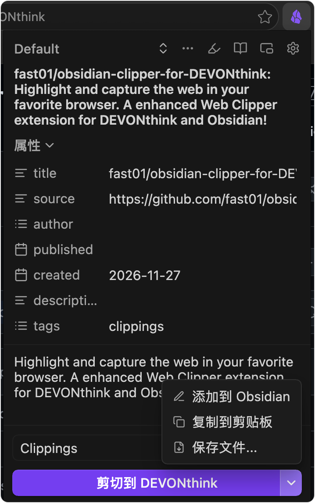

# Obsidian Web Clipper for DEVONthink

> **This is a fork**: [fast01/obsidian-clipper-for-DEVONthink](https://github.com/fast01/obsidian-clipper-for-DEVONthink), based on [obsidianmd/obsidian-clipper](https://github.com/obsidianmd/obsidian-clipper). Development happens on the `devonthink-clip` branch.

An enhanced Web Clipper that clips web pages **directly into DEVONthink** as Markdown, while keeping the original Obsidian behavior available. The default output target is DEVONthink; use the dropdown next to the main button to switch to Obsidian, copy to clipboard, or save a file.

## 📦 Download

**[⬇️ Download the latest extension ZIP](https://github.com/fast01/obsidian-clipper-for-DEVONthink/releases/latest/download/obsidian-web-clipper-1.8.5-chrome.zip)** — ~4.4 MB, points to the newest release. ([All releases](https://github.com/fast01/obsidian-clipper-for-DEVONthink/releases))

> To keep the link working across updates, future releases should reuse the same asset filename `obsidian-web-clipper-1.8.5-chrome.zip`. If a release renames it, update this link too.



## What's different from upstream

- **DEVONthink as the default target** — clips go straight into DEVONthink via its `x-devonthink://createMarkdown` URL command (DEVONthink 4.4.2+ on macOS).
- **Destination group** — set a group UUID (or paste its full item link) in settings to file clips into a specific group instead of the default Inbox. Tags are supported too.
- **"Clip highlights"** — saves only the passages you highlighted, both on normal pages and in reader mode; reader mode also has a toolbar button for it, and highlighted passages can be removed there.
- **One switch, four targets** — the main button follows the selected save behavior; the other three targets stay one click away in the dropdown.
- **Markdown or HTML output** — a format switch right above the main button lets you save either clean Markdown or the full HTML (preserves original page formatting). Your choice is remembered for next time.

See [改造说明.md](改造说明.md) for the full design notes, mechanism, and known limitations (Chinese).

## How to use

### Install

1. Download the ZIP from the link above and **unzip it** to a folder you'll keep (e.g. `obsidian-clipper-for-DEVONthink`).
2. In your browser go to `chrome://extensions` (Chrome/Brave/Arc) or `edge://extensions` (Edge), turn on **Developer mode**.
3. Click **Load unpacked** and select the **unzipped folder** (the one containing `manifest.json`).
4. After every update: download the new ZIP, extract over the same folder, then click the extension's **Reload** button on the extensions page.

> Don't try to install a `.crx` by dragging it into the browser: current Chrome/Edge reject CRX files that aren't signed by the Web Store. Load the unpacked folder instead. The ZIP is just a convenient way to distribute that folder.

### Set up DEVONthink

All DEVONthink options live in the extension's **Settings** page (right-click the toolbar icon → Options, or `chrome://extensions` → Details → Extension options), under **Behavior**:

1. **Save behavior → `Clip to DEVONthink`**. This is the default. The main button then reads "Clip to DEVONthink"; the other targets (Add to Obsidian / Copy to clipboard / Save file) remain in the dropdown arrow next to it.
2. **DEVONthink destination UUID** (optional) — where clips are filed:
   - Leave it **empty** to pick the destination group in DEVONthink each time.
   - To always use the same group, in DEVONthink right-click the database or group → **Copy Item Link**, then paste the whole link here (e.g. `x-devonthink-item://B07187CC-...`). A bare UUID works too. With this set, clips go straight into that group with no prompt.
3. **DEVONthink tags** (optional) — comma-separated tags added to each clipped document, e.g. `web, reading`.

Notes:

- You need **DEVONthink 3/4 on macOS** running (the `x-devonthink` URL scheme is registered by the app). DEVONthink will come to the foreground when a clip is sent.
- The clip is created as a **Markdown document** with YAML frontmatter (`title`, `source`, `author`, `published`, `created`, `description`, `tags`). The source URL is preserved in `source`.
- The main button clips the article body. To save only highlighted passages, see below.

### Choose the output format

Above the main button there is a **Format** switch with **Markdown** and **HTML**:

- **Markdown** (default): clean Markdown with YAML frontmatter — best for notes, search and linking.
- **HTML**: saves the extracted page HTML into a DEVONthink HTML document — preserves the original formatting (tables, nested structure, styling) much better.

The selection is remembered and reused next time. Both formats support destination groups, tags, and highlighted clips. Very large pages may exceed the URL-command size limit; if that happens, use Markdown.

### Clip highlights

1. Select text on the page with the mouse to create highlights (with the highlighter pen turned on in the toolbar/menu).
2. Click the purple **Clip highlights** button — in the highlighter menu on normal pages, or the toolbar button (next to the pen) in reader mode.
3. The popup opens with **only the highlighted passages** in the content box; click **Clip to DEVONthink** to save them as Markdown.
4. Clicking a highlight shows a floating **Remove** button, so you can delete individual highlights (also works in reader mode).

### Build from source (optional)

```bash
git clone -b devonthink-clip https://github.com/fast01/obsidian-clipper-for-DEVONthink.git
cd obsidian-clipper-for-DEVONthink
npm ci
./build.sh
```

`./build.sh` builds to `dist/` and writes the distributable ZIP under `builds/`. Optionally set `EDGE_DIR=/path/to/unpacked/folder` to auto-sync the build into your browser's load directory.

---

## Upstream README (original)

The following is the original project's README, kept for reference.

---

Obsidian Web Clipper helps you highlight and capture the web in your favorite browser. Anything you save is stored as durable Markdown files that you can read offline, and preserve for the long term.

- **[Download Web Clipper](https://obsidian.md/clipper)**
- **[Documentation](https://help.obsidian.md/web-clipper)**
- **[Troubleshooting](https://help.obsidian.md/web-clipper/troubleshoot)**

## Get started

Install the extension by downloading it from the official directory for your browser:

- **[Chrome Web Store](https://chromewebstore.google.com/detail/obsidian-web-clipper/cnjifjpddelmedmihgijeibhnjfabmlf)** for Chrome, Brave, Arc, Orion, and other Chromium-based browsers.
- **[Firefox Add-Ons](https://addons.mozilla.org/en-US/firefox/addon/web-clipper-obsidian/)** for Firefox and Firefox Mobile.
- **[Safari Extensions](https://apps.apple.com/us/app/obsidian-web-clipper/id6720708363)** for macOS, iOS, and iPadOS.
- **[Edge Add-Ons](https://microsoftedge.microsoft.com/addons/detail/obsidian-web-clipper/eigdjhmgnaaeaonimdklocfekkaanfme)** for Microsoft Edge.

## Use the extension

Documentation is available on the [Obsidian Help site](https://help.obsidian.md/web-clipper), which covers how to use [highlighting](https://help.obsidian.md/web-clipper/highlight), [templates](https://help.obsidian.md/web-clipper/templates), [variables](https://help.obsidian.md/web-clipper/variables), [filters](https://help.obsidian.md/web-clipper/filters), and more.

## Contribute

### Documentation

User documentation is maintained in the [`en/Obsidian Web Clipper` directory of obsidian-help](https://github.com/obsidianmd/obsidian-help/tree/master/en/Obsidian%20Web%20Clipper).

### Translations

You can help translate Web Clipper into your language. Submit your translation via pull request using the format found in the [/_locales](/src/_locales) folder.

### Features and bug fixes

See the [help wanted](https://github.com/obsidianmd/obsidian-clipper/issues?q=is%3Aissue+is%3Aopen+label%3A%22help+wanted%22) tag for issues where contributions are welcome.

## Roadmap

In no particular order:

- [ ] Annotate highlights
- [ ] Template directory
- [ ] Sync settings across browsers
- [x] A separate icon for Web Clipper (1.6.3)
- [x] Template validation (1.1.0)
- [x] Template logic (if/for)  (1.1.0)
- [x] Save images locally ([Obsidian 1.8.0](https://obsidian.md/changelog/2024-12-18-desktop-v1.8.0/))
- [x] Translate UI into more languages — help is welcomed

## Developers

To build the extension:

```
npm run build
```

This will create three directories:
- `dist/` for the Chromium version
- `dist_firefox/` for the Firefox version
- `dist_safari/` for the Safari version

### Install the extension locally

For Chromium browsers, such as Chrome, Brave, Edge, and Arc:

1. Open your browser and navigate to `chrome://extensions`
2. Enable **Developer mode**
3. Click **Load unpacked** and select the `dist` directory

For Firefox:

1. Open Firefox and navigate to `about:debugging#/runtime/this-firefox`
2. Click **Load Temporary Add-on**
3. Navigate to the `dist_firefox` directory and select the `manifest.json` file

If you want to run the extension permanently you can do so with the Nightly or Developer versions of Firefox.

1. Type `about:config` in the URL bar
2. In the Search box type `xpinstall.signatures.required`
3. Double-click the preference, or right-click and select "Toggle", to set it to `false`.
4. Go to `about:addons` > gear icon > **Install Add-on From File…**

For iOS Simulator testing on macOS:

1. Run `npm run build` to build the extension
2. Open `xcode/Obsidian Web Clipper/Obsidian Web Clipper.xcodeproj` in Xcode
3. Select the **Obsidian Web Clipper (iOS)** scheme from the scheme selector
4. Choose an iOS Simulator device and click **Run** to build and launch the app
5. Once the app is running on the simulator, open **Safari**
6. Navigate to a webpage and tap the **Extensions** button in Safari to access the Web Clipper extension

### Run tests

```
npm test
```

Or run in watch mode during development:

```
npm run test:watch
```

## Third-party libraries

- [webextension-polyfill](https://github.com/mozilla/webextension-polyfill) for browser compatibility
- [defuddle](https://github.com/kepano/defuddle) for content extraction and Markdown conversion
- [dayjs](https://github.com/iamkun/dayjs) for date parsing and formatting
- [lz-string](https://github.com/pieroxy/lz-string) to compress templates to reduce storage space
- [lucide](https://github.com/lucide-icons/lucide) for icons
- [dompurify](https://github.com/cure53/DOMPurify) for sanitizing HTML

## License

Obsidian Web Clipper source code is open source under the MIT License. All trademarks, icons, marketing copy, and other marketing assets are excluded from that license.
